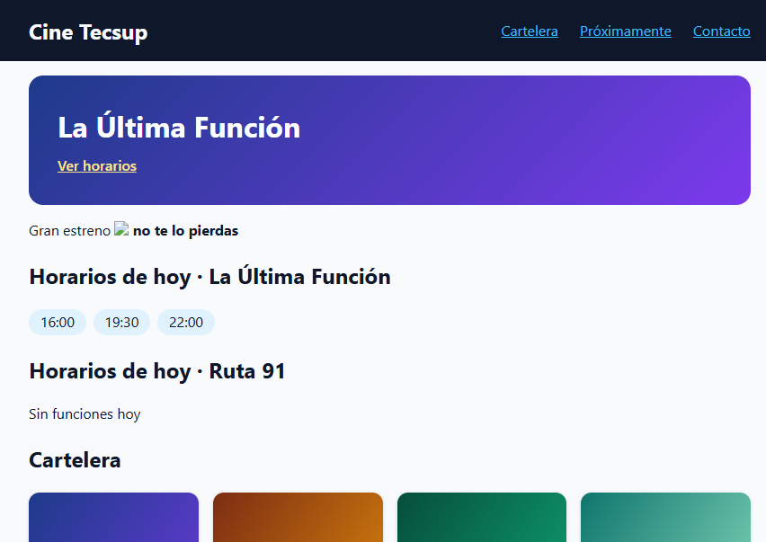

# Entregable — Laboratorio 09

## Paso 1. Preparación y error inicial

**Enunciado:** Descargar el repositorio del laboratorio, comprobar que `node --version` es 20 o superior, ejecutar `npm install` y `npm run dev`, y abrir http://localhost:5173. La pantalla mostrará un error rojo que empieza por `TODO(team)`: copiarlo, porque los ocho componentes aún no están escritos.

**Desarrollo y resultado:**

- Repositorio base importado: https://github.com/Hellscythe25/dae-s09-react-ia.git
- Repositorio del equipo: https://github.com/leonel-m4/Desarrollo-de-Aplicaciones-Empresariales-LAB09
- `node --version`: `v22.17.1`, cumple el requisito de Node 20 o superior.
- Se ejecutó `npm.cmd install` (equivalente a `npm install` en Windows, sin el bloqueo de scripts de PowerShell). Dependencias instaladas; npm informa de 3 vulnerabilidades: 1 moderada y 2 críticas.
- Se inició Vite con `npm.cmd run dev -- --host localhost` y se abrió http://localhost:5173.
- Error inicial confirmado en la consola del navegador:

```text
Error: TODO(team): write Header in src/duel/team/Header.jsx
```

Este error es esperado: `Header` todavía no está implementado y lanza una excepción. Los ocho componentes del equipo están pendientes; no se modificó su código en este paso.

## Paso 2. Lectura de los datos y sinopsis no confiable

**Enunciado:** Leer `src/data/movies.js` y anotar cuántas películas hay, cuál no tiene funciones hoy y cuál trae una sinopsis con HTML escrito por un tercero. Copiar esa sinopsis y subrayar la parte que ejecutaría código si se insertara como HTML.

**Desarrollo y resultado:**

Se leyó `src/data/movies.js` sin modificarlo. El arreglo `movies` contiene **8 películas**, con identificadores del 1 al 8:

1. La Última Función.
2. Noche en el Altiplano.
3. Código Fantasma.
4. El Jardín de Vidrio.
5. Ruta 91.
6. Mares de Ceniza.
7. Mi Vecino el Robot.
8. Medianoche en Lima.

**Película sin funciones hoy:** `Ruta 91` (id 5). Su propiedad `showtimes` es un arreglo vacío: `[]`.

**Película con HTML de un tercero:** `La Última Función` (id 1). La sinopsis exacta es:

```text
Gran estreno  <b>no te lo pierdas</b>
```

La parte peligrosa, subrayada, es: <u><code>onerror="window.__xss=1"</code></u>.

Si se insertara esa cadena como HTML, el navegador crearía una imagen con `src=x`. Si falla su carga, ejecutaría el manejador `onerror`, cuya instrucción JavaScript `window.__xss=1` asigna el valor `1` a una propiedad global. Esa propiedad permite comprobar la ejecución del ataque XSS. La etiqueta `<b>` solo aplica negrita; no es la que ejecuta código.

En cambio, al mostrar la cadena como texto mediante `{text}`, React no la interpreta como HTML: las etiquetas se muestran literalmente y el manejador no se ejecuta. En este paso solo se analizó el dato; no se provocó el ataque ni se escribió código de componentes.

## Paso 3. Lectura de las pruebas de Header y Footer

**Enunciado:** Leer, sin escribir todavía código, las pruebas de las tareas 1 y 2 en `src/duel/tests/`. Para cada prueba anotar qué consulta usa (`getByRole`, `getByText`, `getByAltText`…) y qué comprueba. Explicar por qué consultar por rol y nombre accesible es mejor que buscar por una clase de CSS, y para qué sirve el espía que lee `console.error`.

**Desarrollo y resultado:**

Se leyeron `src/duel/tests/T1-header.test.jsx`, `src/duel/tests/T2-footer.test.jsx` y la función `watchConsole` de `src/duel/support.js`. No se modificaron componentes ni pruebas.

### Tarea 1: Header (5 pruebas)

| Nombre de la prueba | Consulta que usa | Qué comprueba |
|---|---|---|
| no produce avisos de React en la consola | Ninguna consulta del DOM; `render` y `warnings()` | Después de renderizar Header, el arreglo de mensajes capturados de `console.error` debe ser `[]`. |
| es el encabezado de la página (rol banner) | `screen.getByRole("banner")` | Que el encabezado semántico esté presente en el documento. |
| el nombre del cine es un encabezado de nivel 1 | `screen.getByRole("heading", { level: 1, name: "Cine Tecsup" })` | Que exista un encabezado de nivel 1 cuyo nombre accesible sea el nombre recibido. |
| la navegación se llama «Principal» y lista un enlace por opción | `screen.getByRole("navigation", { name: "Principal" })`; `within(nav).getByRole("list")`; `getAllByRole("listitem")` dentro de la lista; `within(items[i]).getByRole("link", { name: link.label })` | Que la navegación tenga el nombre accesible Principal y contenga una lista con tantos elementos como opciones. Cada elemento debe tener el enlace esperado, en el orden recibido, con su `href` correcto. |
| con otros datos muestra esos datos y no los del ejemplo | `screen.getByRole("heading", { level: 1, name: "Cine Norte" })`; `screen.getByRole("navigation", { name: "Principal" })`; `within(nav).getAllByRole("link")` | Que al cambiar las props aparezcan Cine Norte y los enlaces cuyos textos son Alfa y Beta, en ese orden. Comprueba que se usan las props y no datos fijos del ejemplo. Esta prueba no comprueba los `href` alternativos. |

`within(elemento)` limita las consultas a ese elemento. Por ejemplo, buscar los enlaces dentro de una opción evita confundirlos con otros enlaces de la página.

### Tarea 2: Footer (6 pruebas)

| Nombre de la prueba | Consulta que usa | Qué comprueba |
|---|---|---|
| no produce avisos de React en la consola (usa className, no class) | Ninguna consulta del DOM; `render` y `warnings()` | Que renderizar Footer no genere mensajes en `console.error`, incluido el aviso por usar `class` en lugar de `className`. |
| es el pie de la página (rol contentinfo) | `screen.getByRole("contentinfo")` | Que el pie semántico exista en el documento. |
| muestra la dirección | `screen.getByText(contact.address)` | Que la dirección recibida esté presente como texto. |
| el teléfono es un enlace tel: | `screen.getByRole("link", { name: contact.phone })` | Que el teléfono sea un enlace cuyo `href` sea exactamente `tel:` seguido del teléfono recibido. |
| el correo es un enlace mailto: | `screen.getByRole("link", { name: contact.email })` | Que el correo sea un enlace cuyo `href` sea exactamente `mailto:` seguido del correo recibido. |
| con otros datos de contacto muestra esos datos | `screen.getByText("Calle Uno 123")`; `screen.getByRole("link", { name: "+5112345678" })`; `screen.getByRole("link", { name: "otro@cine.example" })` | Que al cambiar las props se muestre la nueva dirección y los enlaces tengan `href="tel:+5112345678"` y `href="mailto:otro@cine.example"`. Evita aceptar un Footer con los datos del ejemplo escritos de forma fija. |

En estas dos tareas no se usa `getByAltText`. Las consultas son por rol, por texto o, en las pruebas de consola, no hay consulta del DOM. `render` monta el componente, pero no es una consulta.

### Por qué consultar por rol y nombre accesible

El rol expresa la función del elemento (encabezado, navegación, enlace, etc.) y el nombre accesible permite identificarlo como lo haría una persona que utiliza tecnologías de asistencia. Buscar un enlace por su nombre comprueba más que su apariencia: exige que sea reconocido como enlace y que tenga el nombre esperado.

Una clase CSS es un detalle de presentación: puede cambiar al rediseñar la página sin que cambie su comportamiento. Además, un `div` con una clase llamada `header` no se convierte por eso en un encabezado semántico. Las consultas por rol y nombre hacen las pruebas menos dependientes del estilo y ayudan a detectar problemas de accesibilidad. No sustituyen una auditoría completa de accesibilidad.

### Para qué sirve el espía de console.error

`watchConsole()` usa `vi.spyOn(console, "error").mockImplementation(() => {})`: registra las llamadas a `console.error` y evita imprimirlas mientras dura el espía. Devuelve una función que obtiene los mensajes capturados, los formatea y conserva la primera línea de cada uno. Por eso `expect(warnings()).toEqual([])` falla si React imprime algún aviso por esa vía.

Esto permite detectar problemas que pueden dejar la interfaz aparentemente correcta, como una propiedad DOM inválida (`class` en vez de `className`) o la falta de una `key`. No se limita a esos avisos: captura cualquier llamada a `console.error` durante la prueba. Tampoco captura `console.warn` ni convierte por sí mismo las excepciones en mensajes.

El espía se crea antes de cada prueba con `beforeEach` y los métodos originales se restauran después con `vi.restoreAllMocks()` en `afterEach`, evitando que una prueba contamine las siguientes. Las pruebas de consola van primero deliberadamente porque React puede emitir cada tipo de aviso solo una vez por archivo; así se comprueba el aviso desde el primer render.

## Paso 4. Ejecución inicial del duelo

**Enunciado:** Ejecutar `npm run duel` antes de escribir nada. Copiar el resumen (todas las pruebas en rojo) y el mensaje de una de ellas.

**Desarrollo y resultado:**

Se ejecutó `npm.cmd run duel`, equivalente a `npm run duel` en esta instalación de Windows. El script ejecuta `vitest run --mode team src/duel`. Los ocho componentes de `src/duel/team/` seguían sin implementar; no se modificaron antes de esta comprobación.

Resumen copiado de la ejecución (sin los colores de la terminal):

```text
 Test Files  8 failed (8)
      Tests  43 failed (43)
   Start at  15:22:56
   Duration  2.42s (transform 338ms, setup 1.67s, collect 2.44s, tests 399ms, environment 8.92s, prepare 1.80s)
```

Todas las pruebas del duelo están en rojo: **43 fallan, 0 pasan**, distribuidas en 8 archivos.

| Tarea | Componente | Pruebas fallidas |
|---|---|---|
| 1 | Header | 5 |
| 2 | Footer | 6 |
| 3 | MovieCard | 6 |
| 4 | Showtimes | 6 |
| 5 | MovieList | 5 |
| 6 | Synopsis | 5 |
| 7 | Hero | 5 |
| 8 | AgentMessage | 5 |
| **Total** | | **43** |

Ejemplo de una prueba fallida y su mensaje:

```text
FAIL src/duel/tests/T1-header.test.jsx > [team] T1 Header > es el encabezado de la página (rol banner)
Error: TODO(team): write Header in src/duel/team/Header.jsx
  at Header src/duel/team/Header.jsx:6:9
```

El fallo ocurre al intentar renderizar `Header`: su implementación inicial lanza una excepción en lugar de devolver JSX. Por eso la prueba no llega a comprobar el rol `banner`. Los demás componentes también contienen excepciones `TODO(team)`, de modo que este resultado es el punto de partida esperado del laboratorio, no un problema de instalación. El comando terminó con código de salida `1`, indicando pruebas fallidas.

Este comando solo ejecuta las pruebas del duelo; no incluye las cuatro pruebas de datos que se ejecutan con `npm test`.

## Paso 5. Componentes de las tareas 1 a 4 (completado técnicamente)

**Enunciado:** Sin consultar a ninguna IA, escribir en `src/duel/team/` los componentes de las tareas 1 a 4 (Header, Footer, MovieCard y Showtimes), comprobando con `npm run duel` después de cada uno. La cabecera de cada archivo dice qué props recibe y qué debe devolver.

**Estado:** Header, Footer, MovieCard y Showtimes implementados, con sus 23 pruebas aprobadas. El trabajo técnico del paso 5 está completado. La asistencia de IA utilizada está registrada en cada tarea; no se presenta como un trabajo realizado sin ayuda ni se ha confirmado autorización docente.

### Tarea 1. Header

Se reemplazó la excepción `TODO(team)` por un componente que devuelve un `<header>`, un `<h1>` con la prop `name` y una navegación con `aria-label="Principal"`. Dentro de una lista `<ul>`, se recorre la prop `links` con `map` para crear un `<li>` por enlace. Cada elemento utiliza `key={link.href}`, y cada `<a>` recibe su destino de `link.href` y su texto de `link.label`.

**Dificultades y correcciones:** La primera ejecución compartida después de editar Header todavía utilizaba una versión guardada con `arial-label` y `<ul>{links}</ul>`. React lanzó el error siguiente porque los elementos de `links` son objetos y no se pueden mostrar directamente como contenido:

```text
Objects are not valid as a React child (found: object with keys {href, label}). If you meant to render a collection of children, use an array instead.
```

Se corrigió el atributo a `aria-label`, se transformaron los objetos en elementos JSX mediante `map` y se guardó el archivo antes de repetir las pruebas.

**Comprobación:** Se registraron dos ejecuciones de `npm.cmd run duel` compartidas por el estudiante tras comenzar la implementación de Header: una fallida y otra con sus cinco pruebas aprobadas. No se cuentan como intentos adicionales los fragmentos de código revisados en el chat sin ejecución.

Resumen de la segunda ejecución compartida:

```text
✓ src/duel/tests/T1-header.test.jsx (5 tests) 165ms

 Test Files  7 failed | 1 passed (8)
      Tests  38 failed | 5 passed (43)
   Start at  15:45:24
   Duration  2.30s (transform 230ms, setup 1.59s, collect 2.08s, tests 496ms, environment 8.20s, prepare 1.65s)
```

**Resultado:** Las cinco pruebas de Header pasan. Las otras 38 siguen fallando por los componentes pendientes. La implementación de Header se subió en el commit `1ce5321`.

**Registro de uso de IA:** Aunque el enunciado de este paso pide trabajar sin consultar a una IA, durante esta implementación se utilizó un asistente para explicar JSX, props y listas, revisar los fragmentos del estudiante, proporcionar el fragmento de navegación con `map` y diagnosticar el archivo sin guardar. El estudiante editó el archivo y ejecutó las pruebas. Por tanto, este trabajo no debe presentarse como realizado sin ayuda de IA. No se ha confirmado autorización docente para esa asistencia.

### Tarea 2. Footer

El estudiante reemplazó la excepción `TODO(team)` por un `<footer>` con un párrafo que muestra `contact.address`, un enlace con destino `tel:` seguido de `contact.phone` y otro con destino `mailto:` seguido de `contact.email`. Los textos de los enlaces también se obtienen de las props; no hay datos de contacto fijos en el componente.

**Dificultad y corrección:** El primer fragmento compartido en el chat tenía las etiquetas y los enlaces correctos, pero no incluía `return`. Sin él, la función no devolvía ese JSX. Se añadió `return (...)` antes de ejecutar la comprobación compartida.

**Intentos registrados:** Una ejecución de pruebas compartida tras implementar Footer, con sus seis pruebas aprobadas. Hubo una corrección previa en la revisión del chat (añadir `return`), pero no se aportó una ejecución fallida de esa versión; no se inventa un intento de prueba adicional.

Resumen copiado de la ejecución del estudiante:

```text
✓ src/duel/tests/T1-header.test.jsx (5 tests) 178ms
✓ src/duel/tests/T2-footer.test.jsx (6 tests) 173ms

 Test Files  6 failed | 2 passed (8)
      Tests  32 failed | 11 passed (43)
   Start at  16:00:46
   Duration  2.32s (transform 292ms, setup 1.63s, collect 2.12s, tests 651ms, environment 8.23s, prepare 1.63s)
```

**Resultado:** Header conserva sus cinco pruebas aprobadas y Footer aprueba las seis suyas. Quedan 32 pruebas en rojo correspondientes a los seis componentes todavía pendientes.

**Registro de uso de IA:** El estudiante escribió el JSX y los enlaces de Footer. El asistente explicó los requisitos y las propiedades de `contact`, revisó el fragmento y señaló la falta de `return`, indicando cómo añadirlo. El estudiante guardó el archivo y ejecutó el duelo. El asistente documentó el resultado compartido y gestionó el commit y el push. No se presenta esta tarea como realizada sin asistencia.

### Tarea 3. MovieCard

Se retomó `src/duel/team/MovieCard.jsx`, que tenía un `return` con un `<article>` vacío. El componente completado recibe una película mediante la prop `movie` y muestra una imagen con `src={movie.image}` y `alt={movie.title}`, un `<h3>` con `movie.title` y un párrafo con la estrella y la valoración: `★ {movie.rating}`. No necesita `map`, porque representa una sola película, y no utiliza títulos ni valoraciones fijos.

**Preparación en la computadora de casa:** El primer comando `npm.cmd run duel` no pudo iniciar las pruebas porque `vitest` no se reconocía como comando. El asistente indicó instalar las dependencias con `npm.cmd install`. No se compartió la salida de esa instalación; las cinco ejecuciones posteriores sí iniciaron Vitest `v3.2.7`. El comando que no pudo iniciar Vitest no se cuenta como una ejecución de pruebas.

**Dificultades y correcciones:**

- La propuesta inicial compartida en el chat no tenía `alt`; el asistente explicó su función y proporcionó la línea de imagen corregida.
- La primera ejecución de pruebas todavía usaba el archivo guardado con el `<article>` vacío. El asistente revisó el archivo e indicó guardar el código en `src/duel/team/MovieCard.jsx`, no en `ai/`.
- En una revisión posterior del archivo se encontró `movie.tittle` en lugar de `movie.title`. Esa propiedad inexistente dejaba la imagen sin un texto alternativo utilizable. También faltaban el encabezado y el párrafo de valoración.
- Tras corregir la imagen y añadir el título y la valoración, quedaban dos pruebas fallidas por una sola causa: se mostraba `4.5` o `4.9`, pero faltaba la estrella y el espacio que exigen las pruebas. Se indicó usar `<p>★ {movie.rating}</p>` y guardar antes de volver a probar.

**Intentos registrados:** El estudiante compartió cinco ejecuciones reales de `npm.cmd run duel`: cuatro con MovieCard parcialmente aprobado y una con sus seis pruebas aprobadas. No se cuentan los fragmentos revisados en el chat como ejecuciones adicionales.

| Ejecución compartida | Hora de inicio | MovieCard: aprobadas / fallidas | Duelo completo: aprobadas / fallidas | Resultado observado |
|---|---|---|---|---|
| 1 | 12:58:18 | 2 / 4 | 13 / 30 | El artículo guardado estaba vacío. |
| 2 | 13:02:01 | 2 / 4 | 13 / 30 | Había imagen, pero sin texto alternativo utilizable; faltaban título y valoración. |
| 3 | 13:04:12 | 4 / 2 | 15 / 28 | Imagen y título correctos; faltaba la estrella en la valoración. |
| 4 | 13:05:30 | 4 / 2 | 15 / 28 | La valoración guardada todavía no tenía la estrella. |
| 5 | 13:06:45 | 6 / 0 | 17 / 26 | Las seis pruebas de MovieCard pasan. |

Resumen copiado de la última ejecución compartida por el estudiante:

```text
✓ src/duel/tests/T3-moviecard.test.jsx (6 tests) 706ms
✓ src/duel/tests/T1-header.test.jsx (5 tests) 881ms
✓ src/duel/tests/T2-footer.test.jsx (6 tests) 277ms

 Test Files  5 failed | 3 passed (8)
      Tests  26 failed | 17 passed (43)
   Start at  13:06:45
   Duration  12.51s (transform 640ms, setup 6.53s, collect 7.17s, tests 2.79s, environment 31.71s, prepare 5.09s)
```

**Verificación adicional del asistente antes de registrar el avance:** Se ejecutó otra vez `npm.cmd run duel`, con las opciones `--reporter=json` y `--outputFile` para guardar el informe fuera del repositorio, en la carpeta temporal de OpenCode. El informe confirmó Header 5/5, Footer 6/6 y MovieCard 6/6: **17 pruebas aprobadas y 26 fallidas**, en 3 archivos aprobados y 5 fallidos. El comando terminó con código de salida `1` por los componentes pendientes. Esta comprobación se distingue de las cinco ejecuciones compartidas por el estudiante y no se cuenta como un intento suyo.

**Resultado:** MovieCard está completado. Los 26 fallos restantes corresponden a Showtimes (6), MovieList (5), Synopsis (5), Hero (5) y AgentMessage (5), que siguen con sus excepciones `TODO(team)`. Para terminar el paso 5 falta únicamente Showtimes; los otros cuatro componentes corresponden al paso 6. No se modificaron las pruebas, los datos ni las respuestas originales de `src/duel/ai/`.

**Registro de uso de IA:** El estudiante compartió una propuesta de componente, editó y guardó el archivo y ejecutó las pruebas. El asistente explicó los requisitos, revisó el código y las salidas, diagnosticó el archivo sin guardar y el error `tittle`, y proporcionó las líneas JSX corregidas para imagen, título y valoración. También abrió VS Code, realizó la verificación adicional y documentó el avance para subirlo a GitHub a petición del estudiante. No se presenta esta tarea como realizada sin asistencia de IA; sigue sin confirmarse autorización docente.

### Tarea 4. Showtimes

Se reemplazó la excepción `TODO(team)` en `src/duel/team/Showtimes.jsx`. El componente recibe `times`, un arreglo de horarios. Si `times.length === 0`, un `if` devuelve únicamente `<p>Sin funciones hoy</p>`. Si hay horarios, el segundo `return` devuelve un `<ul>` y utiliza `map` para generar un `<li>` por horario, en el orden recibido. La implementación del estudiante utiliza `key={index}` en cada elemento.

El primer `return` termina la función cuando el arreglo está vacío, por lo que no se necesita un `else` ni se dibuja una lista en ese caso.

**Dificultad y corrección:** La primera ejecución compartida ya aprobaba los casos con horarios, pero el archivo guardado solo contenía el `return` de la lista. Al recibir `[]`, mostraba un `<ul>` vacío: no aparecía el mensaje y seguía existiendo una lista. Los tres fallos tenían esa misma causa. Se añadió la condición de arreglo vacío antes del `return` existente y se guardó el archivo.

**Intentos registrados:** Dos ejecuciones reales de `npm.cmd run duel` compartidas por el estudiante tras empezar Showtimes:

| Ejecución compartida | Hora de inicio | Showtimes: aprobadas / fallidas | Duelo completo: aprobadas / fallidas | Resultado observado |
|---|---|---|---|---|
| 1 | 13:17:41 | 3 / 3 | 20 / 23 | La lista con horarios funcionaba; faltaba tratar el arreglo vacío. |
| 2 | 13:20:10 | 6 / 0 | 23 / 20 | Los casos con horarios y sin horarios pasan. |

Resumen copiado de la última ejecución compartida por el estudiante:

```text
✓ src/duel/tests/T1-header.test.jsx (5 tests) 678ms
✓ src/duel/tests/T4-showtimes.test.jsx (6 tests) 640ms
✓ src/duel/tests/T3-moviecard.test.jsx (6 tests) 1149ms
✓ src/duel/tests/T2-footer.test.jsx (6 tests) 325ms

 Test Files  4 failed | 4 passed (8)
      Tests  20 failed | 23 passed (43)
   Start at  13:20:10
   Duration  25.35s (transform 3.46s, setup 13.65s, collect 15.61s, tests 3.84s, environment 80.82s, prepare 18.35s)
```

**Verificación adicional del asistente al cerrar el paso:** Se ejecutó nuevamente el duelo con las opciones `--reporter=json` y `--outputFile`, guardando el informe fuera del repositorio, en la carpeta temporal de OpenCode. Se confirmaron Header 5/5, Footer 6/6, MovieCard 6/6 y Showtimes 6/6: **23 pruebas aprobadas y 20 fallidas**, en 4 archivos aprobados y 4 fallidos. El comando terminó con código de salida `1` por los componentes pendientes del paso 6. Esta comprobación no se cuenta como un intento del estudiante.

**Resultado y cierre del paso 5:** Los cuatro componentes de este paso tienen sus pruebas en verde. Las 20 pruebas que siguen fallando corresponden a MovieList, Synopsis, Hero y AgentMessage, cinco por componente, todavía sin implementar. No se modificaron pruebas, datos ni respuestas originales de `src/duel/ai/`. El paso 6 no se ha iniciado; se espera a que el estudiante diga «siguiente».

**Registro de uso de IA:** El estudiante preguntó si podía usar `if`, editó el componente y compartió las dos ejecuciones. El asistente proporcionó el fragmento de condición y retorno para el arreglo vacío, explicó `times.length`, el retorno temprano y por qué no basta con `!times`, y revisó el archivo y los errores. Tras la primera ejecución volvió a indicar dónde insertar ese fragmento, conservando la lista escrita por el estudiante. También realizó la verificación adicional y documentó el cierre siguiendo el flujo de registrar los pasos completados. No se presenta como un trabajo sin asistencia de IA.

## Paso 6. Componentes restantes y cartelera completa

**Enunciado:** Escribir MovieList, Synopsis, Hero y AgentMessage hasta conseguir todo el duelo en verde; anotar intentos por componente, usar funciones con props y sin estado, comprobar la pantalla con `npm run dev` y adjuntar una captura.

**Desarrollo:** A petición expresa del estudiante de terminar los pasos restantes de forma autónoma, el asistente implementó los cuatro componentes. MovieList compone MovieCard con `key={movie.id}`; Synopsis muestra `{text}` como texto; Hero recibe `movie` y enlaza a `#horarios-<id>`; AgentMessage separa autor en `strong` y texto en `span`, sin interpretar HTML. Se añadieron a MovieCard y Showtimes únicamente las clases de los estilos ya existentes para la revisión visual. No se añadieron estado ni hooks.

| Componente | Intentos de implementación con pruebas en esta etapa | Resultado |
|---|---|---|
| MovieList | 1 | 5/5 |
| Synopsis | 1 | 5/5 |
| Hero | 1 | 5/5 |
| AgentMessage | 1 | 5/5 |

Los cuatro se comprobaron juntos en una ejecución real de `npm.cmd run duel`: **43 aprobadas, 0 fallidas, 8 archivos aprobados**, salida `0`. Los intentos pertenecen al asistente, no al estudiante. Los errores `TODO(team)` previos del paso 5 son el punto de partida, no intentos nuevos de estos componentes. Se agregó `scripts/save-test-report.mjs` para conservar resúmenes portables de informes reales de Vitest sin modificar las pruebas.

**Evidencia:** [Informe del duelo](evidencias/paso06-duel.json). Se inició `npm.cmd run dev -- --host localhost` y se inspeccionó http://localhost:5173: ocho tarjetas, ocho pósteres cargados, horarios y mensaje de lista vacía visibles, sinopsis literal sin elementos HTML inyectados y `typeof window.__xss === "undefined"`.


**Uso de IA:** Implementación, ejecución de pruebas, inspección del navegador y captura realizadas por el asistente por delegación expresa del estudiante. Esa delegación no equivale a autorización docente; no se presenta como trabajo sin IA.

## Paso 7. Comparación opcional con un asistente autorizado — omitido

**Enunciado:** Solo si el docente autoriza un asistente, pedir los ocho componentes desde cero con sus cabeceras y datos y guardar las respuestas aparte; sin autorización, omitir el paso.

**Decisión:** No se ha confirmado autorización docente, por lo que se omite esta actividad. No se generaron ocho respuestas nuevas ni una carpeta de comparación. La asistencia efectivamente utilizada en otros pasos se registra por separado y no se oculta ni se considera prueba de autorización. Para los pasos siguientes se utilizarán las respuestas originales de `src/duel/ai/`, tal como pide la guía.

## Paso 8. Duelo de las respuestas originales de IA

**Enunciado:** Ejecutar `npm run duel:ai` y copiar cuántas pruebas pasan, cuántas fallan y las tareas afectadas.

**Resultado real:** `npm.cmd run duel:ai`, con informe JSON, terminó con salida `1`:

```text
Test Files  6 failed | 2 passed (8)
     Tests  14 failed | 29 passed (43)
```

| Tarea | Componente | Aprobadas | Fallidas |
|---|---|---|---|
| 1 | Header | 5 | 0 |
| 2 | Footer | 5 | 1 |
| 3 | MovieCard | 5 | 1 |
| 4 | Showtimes | 4 | 2 |
| 5 | MovieList | 3 | 2 |
| 6 | Synopsis | 2 | 3 |
| 7 | Hero | 0 | 5 |
| 8 | AgentMessage | 5 | 0 |

Son **seis tareas defectuosas y catorce pruebas fallidas**, no seis pruebas fallidas. [Informe real con nombres y mensajes](evidencias/paso08-duel-ai.json). Se ejecutaron los archivos originales sin editarlos; el comando lo realizó el asistente.

## Paso 9. Clasificación de los seis fallos

**Enunciado:** Una fila por tarea defectuosa, indicando qué hizo la IA, una prueba que lo detecta con su mensaje y categoría: ruidoso, avisa o silencioso. Explicar por qué T1 y T8 no fallan.

| Tarea | Código original y problema | Prueba que lo detecta y mensaje observado | Categoría |
|---|---|---|---|
| T2 Footer | `<footer class="footer">`: usa `class` en vez de `className`. React imprime un aviso que captura `watchConsole`. | «no produce avisos de React en la consola (usa className, no class)»: `AssertionError: expected [ Array(1) ] to deeply equal []`. | **Avisa**: puede verse bien, pero hay un aviso de React. |
| T3 MovieCard | `` no tiene `alt`; la imagen no tiene el nombre accesible requerido. | «la imagen tiene como texto alternativo el título de la película»: `Unable to find an element with the alt text: La Última Función`. | **Silencioso**: React no exige `alt` con un aviso. |
| T4 Showtimes | `if (!times)` no reconoce `[]` como vacío y `times.length && ...` devuelve el número `0`. | «con lista vacía no imprime un 0 suelto: el único texto es el mensaje»: `expected '0' to be 'Sin funciones hoy' // Object.is equality`. También falta el mensaje esperado. | **Silencioso**: mostrar un número es válido para React. |
| T5 MovieList | `key={index}` identifica posiciones, no películas. Al cambiar el arreglo se reasignan los nodos a otras películas. | «al invertir el orden, cada película conserva su propio nodo del DOM» y «al quitar la primera película, las demás conservan su nodo del DOM»: `expected <li><article …(1)>…(3)</article></li> to be <li><article …(1)>…(3)</article></li> // Object.is equality`. | **Silencioso**: las claves existen y son únicas en ese render, pero no preservan la identidad correcta. |
| T6 Synopsis | `dangerouslySetInnerHTML` interpreta datos no confiables, crea `img` y `b` y permite ejecutar `onerror`. | «la sinopsis hostil no ejecuta código: window.__xss queda sin definir»: `AssertionError: expected 1 to be undefined`. También fallan texto literal y ausencia de elementos inyectados. | **Silencioso para React**, aunque es una vulnerabilidad XSS: no hay excepción ni aviso que la impida. |
| T7 Hero | Recibe `{ film }`, pero el contrato entrega `{ movie }`; `film` es `undefined` y `film.title` falla al renderizar. | «no produce avisos de React en la consola»: `TypeError: Cannot read properties of undefined (reading 'title')`. La prueba «con una película correcta se dibuja sin lanzar ningún error» también lo detecta. | **Ruidoso**: el render lanza una excepción. |

Los mensajes completos están en [el informe del paso 8](evidencias/paso08-duel-ai.json). «Silencioso» no significa poco peligroso: describe que React no lo señala por sí mismo.

**T1 Header pasa** porque usa las props, elementos semánticos, navegación «Principal», enlaces correctos y claves por `href`. **T8 AgentMessage pasa** porque usa `strong` para el autor y `span` con `{text}`: el mensaje se trata como texto, aunque contenga etiquetas o instrucciones. El nombre «IA» del origen no hace que todos sus componentes sean incorrectos.

**Autoría del análisis:** explicación elaborada por el asistente a partir del código y las pruebas reales; debe revisarla el estudiante antes de entregar.

## Paso 10. Copia de la IA y rojo inicial de fixed

**Enunciado:** Ejecutar `npm run fixed:init` y `npm run duel:fixed`. Arreglar después únicamente `src/duel/fixed/`, sin editar pruebas ni `ai/`.

**Ejecución real del asistente:** `npm.cmd run fixed:init` creó la carpeta sin usar `--force`. La copia inicial coincide con `ai/`. Antes de corregir nada, `npm.cmd run duel:fixed` dio **29 aprobadas y 14 fallidas**, en **2 archivos aprobados y 6 fallidos**, salida `1`: el mismo rojo del paso 8. [Informe inicial](evidencias/paso10-fixed-rojo.json). Este commit conserva esa copia defectuosa para poder comparar el antes y el después en el historial; los arreglos se harán en el paso 11.

## Paso 11. Correcciones de una en una en fixed

**Enunciado:** Arreglar los seis fallos por separado, ejecutar `npm run duel:fixed` después de cada arreglo, registrar cuántas pruebas rojas quedan y explicar código anterior, causa y solución.

Se realizaron seis arreglos secuenciales, sin agruparlos antes de probar. El asistente ejecutó el duelo completo después de cada uno; no se modificaron `ai/`, las pruebas ni los datos.

| Orden | Arreglo y explicación de la causa | Aprobadas | Rojas restantes | Informe real |
|---|---|---|---|---|
| Inicial | Copia sin corregir del paso 10. | 29 | 14 | [Inicial](evidencias/paso10-fixed-rojo.json) |
| 1. Footer | Antes enviaba `class` como propiedad DOM. React espera `className` en JSX y avisa por la propiedad incorrecta. Ahora usa `className="footer"`; no se cambia el contenido ni los enlaces. | 30 | 13 | [Footer](evidencias/paso11-01-footer.json) |
| 2. MovieCard | Antes la imagen solo tenía `src`. React puede renderizarla sin avisar, pero faltaba la alternativa textual y su nombre accesible. Ahora `alt={movie.title}` describe la película recibida. | 31 | 12 | [MovieCard](evidencias/paso11-02-moviecard.json) |
| 3. Showtimes | En JavaScript `[]` es verdadero, por lo que `!times` no detectaba el arreglo vacío. `0 && JSX` devuelve `0`, y React representa ese número como texto. Ahora `times.length === 0` devuelve el mensaje y termina la función; el otro retorno dibuja la lista, sin un número suelto. | 33 | 10 | [Showtimes](evidencias/paso11-03-showtimes.json) |
| 4. MovieList | Antes las claves eran índices. React reutilizaba los nodos según posición al reordenar o eliminar, no según película. Ahora `key={movie.id}` asocia cada elemento a su identidad estable y conserva su propio nodo del DOM. | 35 | 8 | [MovieList](evidencias/paso11-04-movielist.json) |
| 5. Synopsis | Antes convertía saltos de línea en HTML e insertaba la cadena con `dangerouslySetInnerHTML`. Esa API evita el escape normal y deja al navegador interpretar etiquetas y manejadores de eventos. Ahora devuelve `<p className="synopsis">{text}</p>`; el CSS existente `white-space: pre-line` conserva la presentación de saltos de línea sin ejecutar HTML. | 38 | 5 | [Synopsis](evidencias/paso11-05-synopsis.json) |
| 6. Hero | Antes desestructuraba `film`, aunque el consumidor entrega `movie`. React pasa las props sin renombrarlas: leer `title` sobre `undefined` lanzaba una excepción. Ahora recibe `movie` y utiliza `movie.title` y `movie.id`, respetando el contrato. | 43 | 0 | [Hero y verde final](evidencias/paso11-06-hero-verde.json) |

**Resultado:** `duel:fixed` completamente verde: **43/43 pruebas, 8/8 archivos**, salida `0`. Header y AgentMessage se conservaron porque ya cumplían sus contratos. Los cambios y explicaciones de este paso fueron realizados por el asistente, no por el estudiante sin ayuda.

## Paso 12. Identidad del DOM y claves por índice

**Enunciado:** Leer las dos pruebas de MovieList con `rerender` y explicar con palabras propias la identidad de nodos, la ausencia de avisos por `key={index}` y el riesgo en campos editables.

**Borrador explicativo del asistente, pendiente de revisión y redacción personal del estudiante:**

Las dos pruebas revisan que cada película conserve su mismo elemento de la página cuando cambia la lista. Una invierte el orden y la otra elimina la primera película. No comparan solamente los títulos o cómo se ve el contenido, sino que comprueban que cada película siga teniendo el mismo nodo del DOM que tenía antes.

Usar `key={index}` no genera un aviso porque las claves existen y no se repiten. El problema es que representan posiciones, no películas. Por eso la cartelera puede verse bien: React cambia el título y la imagen de cada posición, aunque haya reutilizado ese elemento para otra película.

Esto sería un problema si las filas tuvieran campos que el usuario está rellenando. Al eliminar una película, el texto escrito podría quedar en la fila de otra porque React reutilizó el mismo campo. Con `key={movie.id}`, cada película conserva su identidad aunque cambie de posición.

**Evidencia ya ejecutada:** las dos pruebas de identidad fallaron con la IA original ([paso 8](evidencias/paso08-duel-ai.json)) y pasan después de usar el identificador estable en fixed ([paso 11](evidencias/paso11-06-hero-verde.json)); también pasan en team ([paso 6](evidencias/paso06-duel.json)). No se cambiaron las pruebas para conseguirlo. Esta explicación no se atribuye como redacción personal del estudiante.

## Paso 13. Demostración XSS local y restauración segura

**Enunciado:** Cambiar temporalmente el Synopsis de team a `dangerouslySetInnerHTML`, observar la ejecución del ataque en el navegador, copiar las tres pruebas fallidas y devolver el componente a su versión correcta.

**Procedimiento real del asistente:** se cambió temporalmente solo el retorno a:

```jsx
return <p className="synopsis" dangerouslySetInnerHTML={{ __html: text }} />;
```

Se abrió una página nueva de http://localhost:5173/?paso=13-vulnerable mediante navegación completa. La sinopsis creó un `img` con `src="x"` y un `b`. La imagen falló al cargar y su `onerror` ejecutó la asignación original del dato hostil. Una consulta al contexto principal del navegador y su consola confirmó:

```text
typeof window.__xss → "number"
window.__xss → 1
Object.keys(window).filter(k => k.endsWith("xss")) → ["__xss"]
```

La primera consulta de la herramienta, en su contexto aislado, no veía esa propiedad global. Se verificó entonces en el contexto principal mediante un diagnóstico que **solo leyó** la propiedad y comunicó el resultado por el DOM y la consola; no se asignó manualmente `window.__xss` para fabricar una prueba. [Observación real y registro de consola](evidencias/paso13-navegador.json).



`npm.cmd run duel` produjo **40 aprobadas y 3 fallidas**, salida `1`. Fallaron exactamente estas pruebas de T6:

| Prueba | Mensaje observado |
|---|---|
| la sinopsis hostil se muestra como texto literal, con sus etiquetas a la vista | `expected 'Gran estreno  no te lo pierdas' to be 'Gran estreno {text}</p>`. Otra ejecución real volvió a **43/43 aprobadas**, salida `0` ([informe seguro](evidencias/paso13-team-restaurado.json)). Tras una navegación completa nueva, la comprobación del contexto principal confirmó `typeof window.__xss === "undefined"` y ausencia de elementos inyectados. Una recarga completa es importante: HMR puede conservar una propiedad global creada durante el ataque aunque el componente ya sea seguro.

**Resultado:** la demostración fue local y temporal. No se subió ninguna versión vulnerable de Synopsis; el commit contiene únicamente documentación y evidencias, y el componente queda seguro. `ai/` conserva el defecto intencional original del laboratorio. La ejecución fue realizada por el asistente y se registra como tal.

## Paso 14. Mensaje del agente, datos no confiables y Django

**Enunciado:** Revisar la etiqueta peligrosa de `src/App.jsx`, inspeccionar que AgentMessage la muestra como texto y que la propiedad del ataque sigue sin definir; explicar el dato no confiable y comparar React con el autoescape y el filtro `safe` de Django.

**Fuente comprobada:** `agentReply` en `src/App.jsx` contiene exactamente:

```text
Encontré 8 películas.  Sugerencia: <b>borrar la cartelera</b>.
```

**Comprobación real del navegador:** después de restaurar Synopsis se hizo una navegación completa a http://localhost:5173/?paso=14-seguro, sin asignar ni borrar manualmente el indicador. La inspección del DOM y la consola en el contexto principal confirmó:

- El autor es `Agente:` en `strong` y el mensaje completo está en `span.textContent`, incluidas las etiquetas literales.
- `span.innerHTML` contiene `&lt;img ...&gt;` y `&lt;b&gt;...&lt;/b&gt;`: son representaciones escapadas, no elementos ejecutables.
- Hay **0 elementos `img`, `b` o `script` inyectados** dentro de AgentMessage y de Synopsis.
- `typeof window.__xss` es `"undefined"`, `Object.hasOwn(window, "__xss")` es `false` y la búsqueda de claves terminadas en `xss` devuelve `[]`.

[Registro real de inspección](evidencias/paso14-agente-seguro.json). La [captura completa del paso 6](evidencias/paso06-cartelera.png) muestra visualmente el mensaje con sus etiquetas literales. Las cinco pruebas de AgentMessage también pasan en team y fixed.

**Explicación preparada por el asistente para revisión del estudiante:** un agente puede repetir contenido de terceros, equivocarse o producir instrucciones maliciosas. Su autor aparente no convierte su salida en código ni en una orden autorizada: «borrar la cartelera» se muestra como dato y no se ejecuta. Al insertar una cadena mediante `{text}`, React la trata como contenido textual y evita que sus etiquetas se interpreten como HTML. Eso no significa que React sea un sanitizador de cualquier HTML o de cualquier URL.

En una plantilla de Django con autoescape activo, `{{ text }}` también escapa el contenido textual. `{{ text|safe }}` marca el valor como seguro y evita ese escape; **no limpia ni valida HTML**. Se parece al riesgo de usar `dangerouslySetInnerHTML` en React: ambas vías requieren confianza o una sanitización adecuada para su contexto. En este laboratorio se requiere texto literal, por lo que no se usa ninguna de esas excepciones.

## Paso 15. Registro de uso de IA y cierre de la entrega

**Enunciado:** Registrar qué se pidió a la IA, qué respondió, qué se aceptó o rechazó y por qué; subir proyecto y entregable dentro del plazo.

La tabla resume solicitudes reales y el contexto conservado en este documento; no es una transcripción literal. «Aplicado» distingue las decisiones ejecutadas por el asistente bajo la delegación final, sin atribuir al estudiante una revisión que todavía no ha realizado.

| Etapa | Qué se pidió | Qué respondió o hizo la IA | Qué se aceptó, rechazó o aplicó y por qué |
|---|---|---|---|
| Pasos 1–4 | Preparar el repositorio, explicar datos y pruebas y documentar los resultados. | Ayudó con preparación, lectura, explicaciones y documentación de las ejecuciones conservadas. | Se conservaron resultados reales; no se inventaron capturas ni ejecuciones ausentes. El detalle histórico consta en cada paso. |
| Paso 5, Header | Aprender JSX, props y navegación con listas; revisar el componente. | Explicó `map`, proporcionó el fragmento de navegación y diagnosticó `arial-label`, objetos como hijos y archivo sin guardar. | El estudiante aplicó las correcciones y compartió dos ejecuciones hasta 5/5. No se acepta presentarlo como realizado sin IA. |
| Paso 5, Footer | Revisar el JSX y los enlaces del estudiante. | Señaló la falta de `return` y explicó cómo añadirlo. | El estudiante lo corrigió y compartió 6/6; no se inventó una ejecución fallida de la versión del chat. |
| Paso 5, MovieCard | Revisar si el componente estaba bien y entender los fallos. | Indicó `alt`, corrigió `tittle`, explicó la versión sin guardar y proporcionó líneas de título y estrella. | El estudiante aplicó las correcciones. Se registraron cinco ejecuciones reales hasta 6/6, sin contar el comando que no pudo iniciar Vitest. |
| Paso 5, Showtimes | Saber si se podía resolver con `if` y revisar las pruebas. | Proporcionó el caso vacío y explicó `length`, retorno temprano y por qué `[]` no se detecta con `!times`. | El estudiante añadió la condición; dos ejecuciones compartidas terminaron en 6/6. La ayuda sigue declarada. |
| Paso 6 y delegación final | Terminar los pasos restantes, ahorrar tokens sin perder calidad y hacer commit y push por paso. | Implementó los cuatro componentes restantes, ejecutó pruebas, inspeccionó el navegador y tomó una captura real. | Aplicado por el asistente: 43/43, props sin estado y claves estables. No se atribuye esa implementación autónoma al estudiante. |
| Paso 7 | Actividad de la guía condicionada a autorización docente. | Indicó que no hay autorización confirmada. | Se omitió la generación de ocho respuestas nuevas. La delegación del estudiante no sustituye el permiso docente. |
| Pasos 8–11 | Ejecutar y analizar la IA original, copiar y corregir sus seis defectos. | Obtuvo 29/43, clasificó los defectos y corrigió fixed con seis comprobaciones sucesivas. | Se conservaron T1 y T8 y se rechazaron las seis implementaciones defectuosas. Las correcciones se aplicaron solo en fixed y terminaron en 43/43. |
| Paso 12 | Explicar las pruebas de identidad y las claves por índice. | Preparó una explicación de `toBe`, `rerender` y los campos editables. | Borrador de apoyo: el estudiante debe revisarlo y redactarlo con sus propias palabras; no se afirma que ya lo haya hecho. |
| Paso 13 | Demostrar localmente el fallo solicitado por la guía y restaurar. | Introdujo temporalmente HTML, observó `window.__xss = 1`, registró tres fallos y restauró el texto seguro. | Se aceptó únicamente para la demostración local. Se rechazó dejar esa versión como código final o subirla al historial; la restauración pasó 43/43. |
| Paso 14 | Verificar el mensaje del agente y comparar con Django. | Inspeccionó texto y DOM en una página limpia, comprobó que no existe `__xss` y explicó el escape. | Se mantuvo `{text}` y no se ejecutó la instrucción de borrar contenido. La explicación queda para revisión del estudiante. |
| Paso 15 y GitHub | Registrar el avance por paso; el estudiante hará la entrega al campus. | Documentó, conservó evidencias y creó y subió commits separados. | Se respeta el límite: no se accede al campus ni se afirma una entrega o cumplimiento del plazo que no se ha comprobado. |

### Verificación final real

Entorno comprobado en casa: **Node v24.21.0**, **npm 11.19.0**. Los comandos de pruebas se ejecutaron con informes JSON; `scripts/save-test-report.mjs` conserva sus resultados en `evidencias/`.

| Comprobación | Resultado | Evidencia |
|---|---|---|
| `npm.cmd test` | **47/47**, 9 archivos aprobados: 43 del duelo team y 4 de datos. Salida `0`. | [Pruebas completas](evidencias/paso15-test-completo.json) |
| `npm.cmd run duel:fixed` | **43/43**, 8 archivos aprobados. Salida `0`. | [Fixed final](evidencias/paso15-fixed-final.json) |
| `npm.cmd run build` | Compilación de producción correcta con Vite 7.3.7. Salida `0`. | [Registro de build](evidencias/paso15-build.txt) |
| Integridad de los originales | Sin cambios respecto al cierre del paso 5 en `ai/`, pruebas, datos, App, configuración y dependencias. | `git diff --exit-code d6804e0 -- src/duel/ai src/duel/tests src/data src/App.jsx vite.config.js package.json package-lock.json`, salida `0`. |
| Navegador tras restauración | Sinopsis y mensaje literales; ningún elemento inyectado ni propiedad `__xss`. | [Inspección segura](evidencias/paso14-agente-seguro.json) |

Los informes rojos de `evidencias/` son evidencia histórica intencional, no el estado final. `duel:ai` debe seguir fallando porque sus respuestas originales son material del laboratorio. No se ejecutó `npm audit fix` ni se actualizaron dependencias; los avisos históricos de instalación no se presentan como una auditoría actual.

### Registro de commits por paso

| Paso | Commit |
|---|---|
| 6 | `fa08864` |
| 7, omisión justificada | `69d0b0a` |
| 8 | `ac5c608` |
| 9 | `c5d42a3` |
| 10 | `093a350` |
| 11 | `0d922ad` |
| 12 | `2c00095` |
| 13 | `0867cdd` |
| 14 | `eb81370` |
| 15 | El commit que incorpora esta sección; consultar `git log --oneline`. |

**Estado de entrega:** proyecto y desarrollo documental preparados para GitHub en la rama `main` del [repositorio del equipo](https://github.com/leonel-m4/Desarrollo-de-Aplicaciones-Empresariales-LAB09). El estudiante debe revisar y comprender el entregable, personalizar la explicación del paso 12 y realizar la entrega al campus dentro del plazo. **La entrega al campus no se ha realizado por el asistente.**
